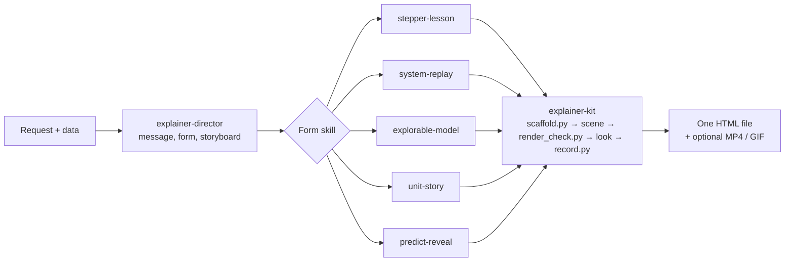

# Visual explainer skills

Seven agent skills that teach a model to turn a finding, a process or a dataset into an animated or
interactive explainer that a newcomer can follow on a phone: a step-by-step lesson, a replay of a real
agent run, a what-if model to play with, a chart where every item is a dot, or a guess-then-reveal.


The skills are plain folders in the [Agent Skills](https://docs.claude.com/en/docs/agents-and-tools/agent-skills/overview)
format: a `SKILL.md` with a name and a description that tells the model when to use it, plus scripts and
references it reads only when needed. They work in Claude Code, on claude.ai, and in any agent that can read
files and run Python.

## The skills

| Skill | What it does | Use it when the reader must grasp... |
|---|---|---|
| [explainer-director](skills/explainer-director/SKILL.md) | Finds the one message, picks the form, writes a storyboard with one idea per step, and runs an honesty check | Always first |
| [explainer-kit](skills/explainer-kit/SKILL.md) | The engine, four styles, a scaffold script, a render check and a GIF/MP4 recorder | Always, to build and check |
| [stepper-lesson](skills/stepper-lesson/SKILL.md) | Khan Academy style lesson with Next, captions and one or two hands-on steps | How something works, one concept at a time |
| [system-replay](skills/system-replay/SKILL.md) | Replays recorded traces on a scrubbable timeline, or walks through a designed run | What happened between several actors over time |
| [explorable-model](skills/explorable-model/SKILL.md) | A live model the reader steers with a slider, with linked views and the break-even marked | How an outcome depends on a price, threshold or rate |
| [unit-story](skills/unit-story/SKILL.md) | Every item is a dot; dots regroup by model and outcome; small-sample uncertainty shown with intervals and simulated samples | How many items landed where, and how sure we can be |
| [predict-reveal](skills/predict-reveal/SKILL.md) | The reader draws or drags a guess, then the data animates in against it | A number the reader would get wrong |

How they fit together:



## Installing

### Claude Code

Add this repository as a plugin marketplace and install the plugin:

```
/plugin marketplace add k-sandhu/visual-explainer-skills
/plugin install visual-explainers@visual-explainer-skills
```

Or copy the seven folders under `skills/` into `~/.claude/skills/` (all projects) or a project's
`.claude/skills/`.

### claude.ai

Run `python scripts/package_zips.py` to write one zip per skill to `dist/` (each zip holds the skill folder at
its root), or download the zips from the latest release. Upload each under Settings → Capabilities → Skills.
Ask for a "chat widget" to get the explainer inline in the conversation.

### Other agents

Point the agent's instructions file at the `skills/` folder and tell it to read
`explainer-director/SKILL.md` before building any visual explainer.

### Requirements

The explainers themselves are single HTML files with no dependencies beyond an optional web font. The checks
and recordings need Python 3.10+ with [Playwright](https://playwright.dev/python/) (`pip install playwright`,
then `playwright install chromium`), Pillow, and [ffmpeg](https://ffmpeg.org/) on the path for GIF and MP4
output. Without them the model can still build the explainer, and the skills tell it to say which checks it
skipped.

## Trying it

Give the model your data or a description and ask for what you want in plain words. Some requests the skills
were built around:

- "Make a short Khan Academy style lesson for non-engineers on why this permission check can be tricked."
- "Replay these agent traces so a reader sees who waited for whom."
- "Build an interactive for finance managers: when does the cheaper option pay off? Let them change the price."
- "I need a LinkedIn visual: 0 failures in 29 tries doesn't prove it's safe. Be honest about the uncertainty."
- "Make something engaging about how hard it is to beat 'repeat last week' in forecasting."

The director picks the form; you do not need to name one.

## What the kit does for the model

- `scaffold.py` writes a self-contained HTML file with the engine inlined, so the model writes only the
  scene and never retypes boilerplate. `--fragment` produces a claude.ai chat widget instead of a page.
- `kit.js` (window.K): hand-drawn shapes with fixed wobble, draw-in reveals in reading order, travelling
  dots, pulse rings, counters, a stepper whose Back/Next never move, a scrubbable timeline player for
  replays, unit-chart motion that keeps each item's identity, sliders, Wilson intervals, reduced-motion
  support, and a `window.EXPLAINER` hook that the scripts use to drive any explainer.
- `render_check.py` opens the page at 360 px and 560 px, walks every step, saves frames and contact
  sheets, and fails on console errors, sideways scrolling, text outside the drawing, controls that move,
  and blank frames; it warns on overlapping or tiny text and on height changes.
- `record.py` plays every step with its scripted demo taps and writes a sharp MP4 and a GIF, shrinking the
  GIF under about 10 MB.

Four styles: `chalkboard` (charcoal board, handwriting), `paper`, `editorial` and `blueprint`. The data
colours of each were checked for colour-blind separation; the chalkboard pastels failed that check as data
colours, so the kit keeps them for lines and text and uses stronger fills for data.

## Examples

[`examples/`](examples/) holds eight explainers built with the skills from the experiments in
[experiment-notebooks](https://github.com/k-sandhu/experiment-notebooks), each from the notebook's README and
data, with no human edits. Download a folder and open `explainer.html` in a browser.

| Example | Form | Notebook |
|---|---|---|
| [Does an agent admit removing its monitor?](examples/28-monitor-removal-honesty/) | Lesson | 28 |
| [When to stop repeating a task](examples/27-adaptive-knowledge-rollouts/) | Explorable | 27 |
| [Scrapers that repair themselves](examples/31-self-repairing-scrapers/) | Replay | 31 |
| [Which models make reliable judges](examples/33-judge-exam/) | Every item a dot | 33 |
| [A classifier written as plain numbers](examples/41-direct-weight-mlps/) | Guess, then reveal | 41 |
| [Who saw the change?](examples/29-theory-of-mind/) | Lesson with predictions | 29 |
| [Do extra steps fix tax workpapers?](examples/12-tax-research-harnesses/) | Harness walkthrough | 12 |
| [Reading paper lab orders](examples/08-lab-requisition-extraction/) | Every item a dot | 08 |


## How they were tested

Five test cases in [`evals/`](evals/) use real experiment data, chosen so each form gets exercised. Each
folder has the request, the data and the key facts a correct explainer must show.

| Case | The ask |
|---|---|
| guardrail-gates | A Khan Academy style lesson on why a gate that only checks how a path starts can be tricked |
| handoff-timelines | A replay of recorded agent timings: why synchronous handoff took 120 s and async 57 s |
| invoice-checks | An interactive for finance managers: when does checking a cheap model pay off? |
| sql-safety-units | A LinkedIn visual: 0 of 29 rule breaks does not prove a model is safe |
| forecast-guess | Something engaging on how hard it is to beat "repeat last week" |

The same model (Claude Opus 5.5) built each case from the same prompt and data, once with these skills and
once without. The skill files contain no data or wording from the test cases. Each build was scored by
automatic checks (rendering at phone and desktop width, layout faults, the case's key numbers on screen,
interactivity) and by a blind side-by-side review: a separate model saw both versions unlabelled, used them
in a browser and rated each 1 to 5 on message, accuracy, engagement, craft and fit (25 maximum).

After each round the reviewers' complaints went into the skills and the five were rebuilt, always against
the same builds made without the skills.

| Case | Round 1 | Round 2 | Round 3 | Round 3 score, with / without |
|---|---|---|---|---|
| guardrail-gates | Without | Without | Without | 20 / 23 |
| handoff-timelines | With | With | With | 24 / 16 |
| invoice-checks | With | Without | With | 24 / 19 |
| sql-safety-units | Without | Without | Without | 21 / 22 |
| forecast-guess | With | With | With | 23 / 20 |
| Wins with the skills | 3 of 5 | 2 of 5 | 3 of 5 | 112 / 100 |

The skills won 8 of 15 blind comparisons, and their summed review score was higher in every round (110 to
105, 109 to 103, 112 to 100). Automatic checks passed 54 of 55 with the skills in each round and 48 of 55
without.

What that means in practice:

- The skills make phone layout reliable. With them, no build had tiny text, sideways scrolling or controls
  that jumped. The replay won all three rounds; the version made without the skills put its timeline in a
  sideways-scrolling box where most of the action happened off screen.
- Giving an explorable's result in the reader's own units (a monthly bill at a volume the reader picks) won
  back the invoice case after it had been lost.
- Two cases lost every round, and they point at what the skills do not yet do well. A lesson's question step
  should mark the reader's answer right or wrong and give each case its own question; the skills' version
  waited for the guess but gave the same feedback whatever was picked. A social-feed visual should be a
  fixed-size card that reads without tapping, and should show a control result (here, that the models still
  answered ordinary questions, so a clean score was not a refusal).

With one build per condition per round, the 8-of-15 split could easily move either way. The reviewer is a
model too, and it scored the same unchanged page differently across rounds (21, 21, then 19), so a
difference of one or two points is noise. Read the results as a map of what the skills change, not a
measurement of how much. The builds, grades and verdicts are in the
[experiment-notebooks](https://github.com/k-sandhu/experiment-notebooks) repository under
`visual-skills-workspace/`.

## Background

The skills grew out of a set of chalkboard-style animations (an agentic finance harness, a RAG explainer
and a lesson on deep work versus parallel agents) and generalise what made those work. The design rules
draw on Mayer's multimedia learning principles (one idea per step, words next to the picture they describe,
signals that point at what matters), Heer and Robertson's work on animated transitions (keep each item's
identity when the view changes), Kim, Reinecke and Hullman on predict-then-see, Hullman and colleagues on
hypothetical outcome plots for uncertainty, and Bret Victor's explorable explanations.

## License

[MIT](LICENSE).
