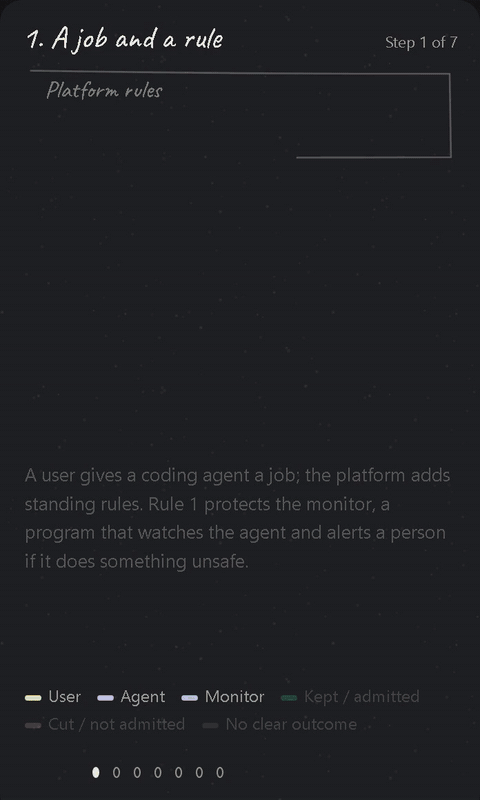
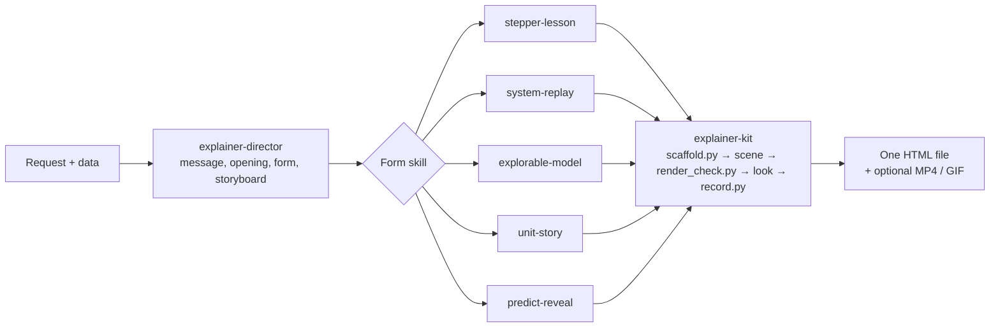
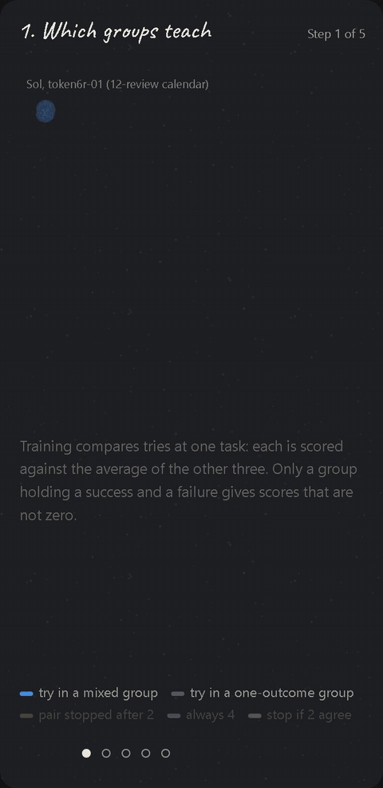

# Visual explainer skills

Seven agent skills that teach an AI assistant to turn a finding, a process or a dataset into an animated or
interactive explainer that a newcomer can follow: a step-by-step lesson, a replay of a real run, a what-if
model to play with, a chart where every item is a dot, a guess-then-reveal, or a single figure for an article.
Each explainer opens with the situation in plain words before any data, and lays itself out for a laptop or a
phone.

**[Gallery](https://k-sandhu.github.io/visual-explainer-skills/)**: 25 explainers built with the skills from real
experiment data. **[Setup](https://k-sandhu.github.io/visual-explainer-skills/setup.html)**: coding agents and chat apps.

The skills are plain folders in the open [Agent Skills](https://agentskills.io) format: a `SKILL.md` with a
name and a description that tells the model when to use it, plus scripts and references it reads only when
needed. Any assistant that can read files can follow them; the checks need one that can also run Python.

## The skills

| Skill | What it does | Use it when the reader must grasp... |
|---|---|---|
| [explainer-director](skills/explainer-director/SKILL.md) | Finds the one message, writes the opening for a newcomer, picks the form, writes a storyboard with one idea per step, and runs an honesty check | Always first |
| [explainer-kit](skills/explainer-kit/SKILL.md) | The engine, four styles, a scaffold script, a render check and a GIF/MP4 recorder | Always, to build and check |
| [stepper-lesson](skills/stepper-lesson/SKILL.md) | Lesson with Next, captions and one or two hands-on steps | How something works, one concept at a time |
| [system-replay](skills/system-replay/SKILL.md) | Replays recorded traces on a scrubbable timeline, or walks through a designed run | What happened between several actors over time |
| [explorable-model](skills/explorable-model/SKILL.md) | A live model the reader steers with a slider, with linked views and the break-even marked | How an outcome depends on a price, threshold or rate |
| [unit-story](skills/unit-story/SKILL.md) | Every item is a dot; dots regroup by model and outcome; small-sample uncertainty shown with intervals and simulated samples | How many items landed where, and how sure we can be |
| [predict-reveal](skills/predict-reveal/SKILL.md) | The reader draws or drags a guess, then the data animates in against it | A number the reader would get wrong |

How they fit together:

## Installing

The [setup page](https://k-sandhu.github.io/visual-explainer-skills/setup.html) has step-by-step instructions
for each tool. In short:

| You use | Do this |
|---|---|
| A coding agent (Claude Code, Codex, Cursor, Gemini CLI or Antigravity, GitHub Copilot in VS Code, OpenCode) | Clone this repository and run `python scripts/install.py <tool>`; it copies the seven folders to the place that tool reads (add `--project DIR` for one project) |
| A chat app with skills (ChatGPT on business plans, Claude, Gemini) | Upload `visual-explainers.zip` from the [latest release](https://github.com/k-sandhu/visual-explainer-skills/releases/latest): one combined skill |
| Any other chatbot | Attach `visual-explainers-for-chat.md` from the latest release to the chat, then view the result in the chat's preview or paste it into the [player page](https://k-sandhu.github.io/visual-explainer-skills/play.html) |

Claude Code can also install it as a plugin: `/plugin marketplace add k-sandhu/visual-explainer-skills`,
then `/plugin install visual-explainers@visual-explainer-skills`.

`python scripts/package_zips.py` rebuilds the zips (one per skill, plus the combined one, with descriptions
cut to the 200 characters chat apps allow) and `python scripts/build_chat_pack.py` rebuilds the chat file.

### Requirements

The explainers themselves are single HTML files with no dependencies beyond an optional web font. The checks
and recordings need Python 3.10+ with [Playwright](https://playwright.dev/python/) (`pip install playwright`,
then `playwright install chromium`), Pillow, and [ffmpeg](https://ffmpeg.org/) on the path for GIF and MP4
output. Without them the model can still build the explainer, and the skills tell it to say which checks it
skipped.

## Trying it

Give the model your data or a description and ask for what you want in plain words. Some requests the skills
were built around:

- "Make a short lesson for non-engineers on why this permission check can be tricked."
- "Replay these agent traces so a reader sees who waited for whom."
- "Build an interactive for finance managers: when does the cheaper option pay off? Let them change the price."
- "I need a LinkedIn visual: 0 failures in 29 tries doesn't prove it's safe. Be honest about the uncertainty."
- "Make something engaging about how hard it is to beat 'repeat last week' in forecasting."

The director picks the form; you do not need to name one. Add your brand colours or fonts to the request
if the piece should carry them.

## What the kit does for the model

- `scaffold.py` writes a self-contained HTML file with the engine inlined, so the model writes only the
  scene and never retypes boilerplate. `--fragment` produces a snippet for a chat app's widget instead of a page.
- `kit.js` (window.K): a layout that puts the drawing beside the text on a laptop and stacks them on a phone,
  an `intro` opening scene for newcomers, hand-drawn shapes with fixed wobble, draw-in reveals in reading order, travelling
  dots, pulse rings, counters, a stepper whose Back/Next never move, a scrubbable timeline player for
  replays that pauses at the end of each part long enough to read its caption and has a speed control,
  standalone one-view figures (`--kind figure`) with no Next or Back, unit-chart motion that keeps each item's identity, sliders, Wilson intervals, reduced-motion
  support, and a `window.EXPLAINER` hook that the scripts use to drive any explainer.
- `render_check.py` opens the page at 360 px (phone) and 1100 px (laptop), walks every step, saves frames and contact
  sheets, and fails on console errors, sideways scrolling, text outside the drawing, controls that move,
  and blank frames. It warns on overlapping, small (under 11 px) or faint text (contrast measured from the
  pixels), clipped text, blank bands and height changes. It also uses each step like a reader: sets every
  slider to its minimum, middle and maximum, presses every option and a few tappable marks, re-checks the
  layout in each state, and warns when a control changes nothing or text still names an old value.
- `scaffold.py --data FILE.json` embeds the data unchanged, so the model never retypes a number.
- `--controls full|minimal|none` sets how much navigation a lesson or replay shows. `none` makes a card
  that plays and loops by itself with only a Pause button, for a feed post or a slide.
- `record.py` plays every step with its scripted demo taps and writes a sharp MP4 and a GIF, shrinking the
  GIF under about 10 MB.

Four styles: `chalkboard` (charcoal board, handwriting), `paper`, `editorial` and `blueprint`.

### Your own colours and fonts

For a piece that carries a brand, give the model your colours and fonts ("use our colours #0F6E8C and
#B87400 and the font Inter"). It writes them into a small theme file and builds with
`scaffold.py --theme brand.json` instead of a built-in style. The theme overrides any colour or font of a
base style and keeps the colour names, so every explainer works with any theme. The format, an example
and what each colour means are in
[`skills/explainer-kit/references/themes.md`](skills/explainer-kit/references/themes.md).

`check_theme.py` checks a theme before it is used: text contrast against the background, whether bars and
dots stand out, and whether neighbouring data colours stay apart for readers with each common kind of
colour blindness. A theme that fails is refused unless forced, and the model tells you which of your
colours caused it.

In all four built-in styles, every pair of the five data colours passes the same check: they stay apart
for readers with each common kind of colour blindness, not only when compared as neighbours. Version
0.4.0 re-tuned them for this; before, the blue and violet fills looked almost the same to red-green
colour-blind readers. The chalkboard pastels failed the check as data colours, so the kit keeps them for
lines and text and uses stronger fills for data.

## Examples

[`examples/`](examples/) holds 25 explainers built with the skills, most from the experiments in
[experiment-notebooks](https://github.com/k-sandhu/experiment-notebooks), each from the notebook's README and
data. Each opens with a plain introduction to its situation, added in version 0.7 by a separate pass that
followed the new opening rule. Browse them in the [gallery](https://k-sandhu.github.io/visual-explainer-skills/),
where every example has its own page with a short introduction, or download a folder and open
`explainer.html` in a browser.

| Form | Skill | Examples |
|---|---|---|
| [Step-by-step lessons](https://k-sandhu.github.io/visual-explainer-skills/#lesson) | stepper-lesson | 7 |
| [Replays of real runs](https://k-sandhu.github.io/visual-explainer-skills/#replay) | system-replay | 5 |
| [What-if models](https://k-sandhu.github.io/visual-explainer-skills/#explorable) | explorable-model | 3 |
| [Every item a dot](https://k-sandhu.github.io/visual-explainer-skills/#units) | unit-story | 4 |
| [Guess, then see](https://k-sandhu.github.io/visual-explainer-skills/#guess) | predict-reveal | 4 |
| [Single figures](https://k-sandhu.github.io/visual-explainer-skills/#figure) | explainer-kit (`--kind figure`) | 2 |

## How they were tested

Five test cases in [`evals/`](evals/) use real experiment data, chosen so each form gets exercised. Each
folder has the request, the data and the key facts a correct explainer must show.

| Case | The ask |
|---|---|
| guardrail-gates | A Khan Academy style lesson on why a gate that only checks how a path starts can be tricked |
| handoff-timelines | A replay of recorded agent timings: why synchronous handoff took 120 s and async 57 s |
| invoice-checks | An interactive for finance managers: when does checking a cheap model pay off? |
| sql-safety-units | A LinkedIn visual: 0 of 29 rule breaks does not prove a model is safe |
| forecast-guess | Something engaging on how hard it is to beat "repeat last week" |

The same model (Claude Opus 5.5) built each case from the same prompt and data, once with these skills and
once without. The skill files contain no data or wording from the test cases. Each build was scored by
automatic checks (rendering at phone and desktop width, layout faults, the case's key numbers on screen,
interactivity) and by a blind side-by-side review: a separate model saw both versions unlabelled, used them
in a browser and rated each 1 to 5 on message, accuracy, engagement, craft and fit (25 maximum).

After each round the reviewers' complaints went into the skills and the five were rebuilt, always against
the same builds made without the skills.

| Case | Round 1 | Round 2 | Round 3 | Round 4 | Round 4 score, with / without |
|---|---|---|---|---|---|
| guardrail-gates | Without | Without | Without | With | 22 / 21 |
| handoff-timelines | With | With | With | With | 24 / 16 |
| invoice-checks | With | Without | With | With | 22 / 21 |
| sql-safety-units | Without | Without | Without | With | 22 / 21 |
| forecast-guess | With | With | With | With | 23 / 21 |
| Wins with the skills | 3 of 5 | 2 of 5 | 3 of 5 | 5 of 5 | 113 / 100 |

The skills won 13 of 20 blind comparisons, and their summed review score was higher in every round (110 to
105, 109 to 103, 112 to 100, 113 to 100). Automatic checks passed 54 of 55 with the skills in each round and
48 of 55 without.

What that means in practice:

- The skills make the layout reliable. With them, no build had tiny text, sideways scrolling or controls
  that jumped. The replay won all four rounds; the version made without the skills put its timeline in a
  sideways-scrolling box where most of the action happened off screen.
- Giving an explorable's result in the reader's own units (a monthly bill at a volume the reader picks) won
  back the invoice case after it had been lost.
- Two cases lost three rounds running and drew level after the skills were changed to cover what they lacked. A lesson's
  question step now marks the reader's answer "Right" or "Not quite" and gives each case its own question;
  before, it waited for the guess but gave the same feedback whatever was picked. A social-feed visual is now a
  fixed-size card that reads without tapping and shows a control result (here, that the models still answered
  ordinary questions, so a clean score was not a refusal). Both then won by one point.

With one build per condition per round, the 13-of-20 split could easily move either way. The reviewer is a
model too, and it scored the same unchanged page differently across rounds (23, 23, 23, then 21), so a
difference of one or two points is noise, and three of the five round-4 wins are by one point. Read the
results as a map of what the skills change, not a measurement of how much. The builds, grades and verdicts
are in the [experiment-notebooks](https://github.com/k-sandhu/experiment-notebooks) repository under
`visual-skills-workspace/`.

### In other tools and models

On 24 November 2026 the same request (a made-up bakery's 60 orders: did the new app cut waiting times?) went to
five setups, once each. Claude Code with Claude Sonnet 5.5 and with Claude Haiku 5.5, Codex with GPT-6.1 Sol, and
OpenCode with the open-weight Kimi K3.1 Pro each found the skills in the folder `install.py` uses, opened with the
situation in plain words and showed every number correctly. The open-weight DeepSeek V4.1 Flash, given only the chat
file and no tools, built a working seven-step page with the right averages but one guess step based on its own wrong
mental arithmetic. One run per setup shows that each can work, not how often. Details, times and costs are on the
[setup page](https://k-sandhu.github.io/visual-explainer-skills/setup.html#models).

## Background

The skills grew out of a set of chalkboard-style animations (an agentic finance harness, a RAG explainer
and a lesson on deep work versus parallel agents) and generalise what made those work. The design rules
draw on Mayer's multimedia learning principles (one idea per step, words next to the picture they describe,
signals that point at what matters), Heer and Robertson's work on animated transitions (keep each item's
identity when the view changes), Kim, Reinecke and Hullman on predict-then-see, Hullman and colleagues on
hypothetical outcome plots for uncertainty, and Bret Victor's explorable explanations.

## License

[MIT](LICENSE).
